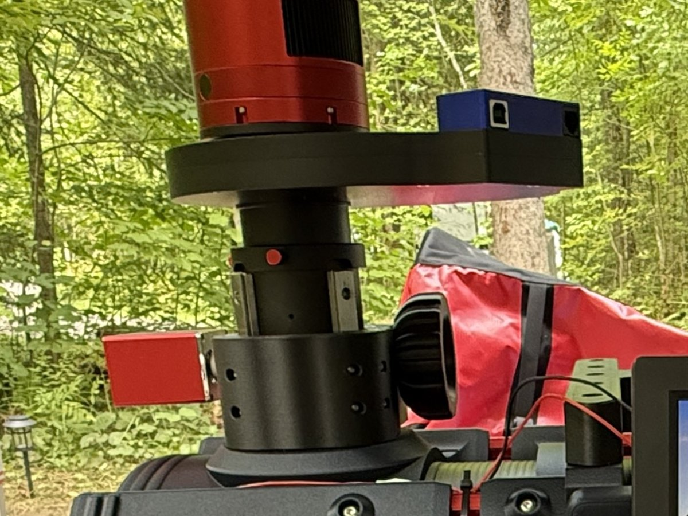
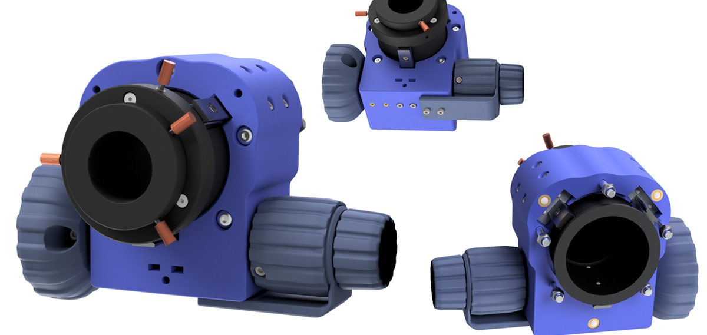
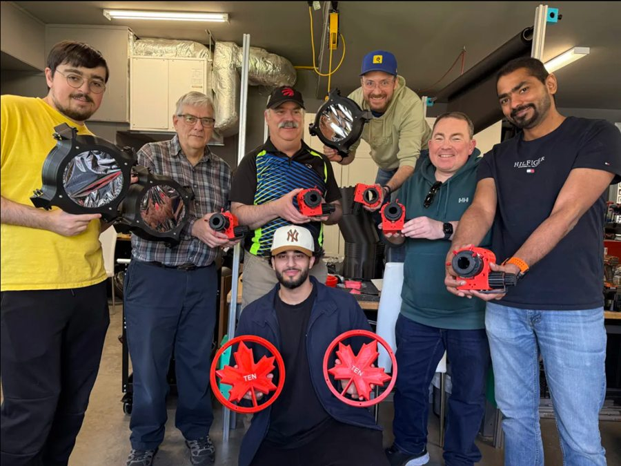
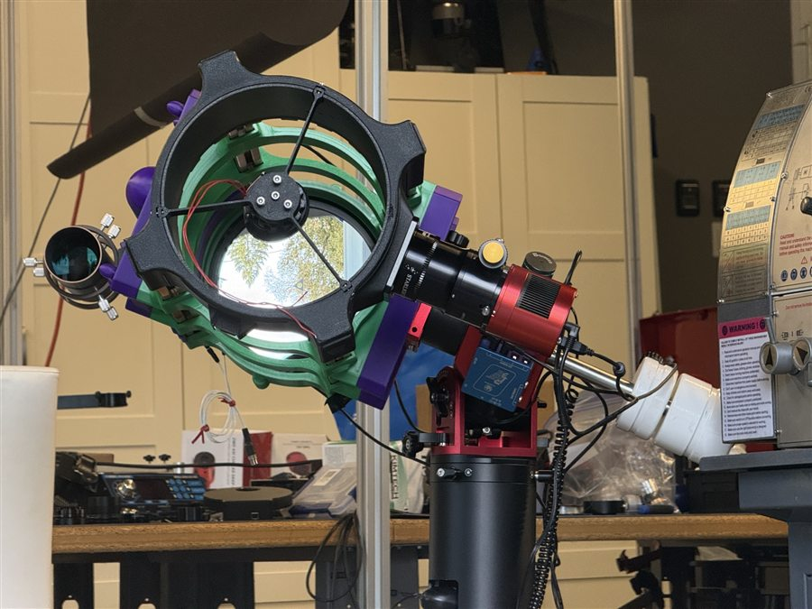
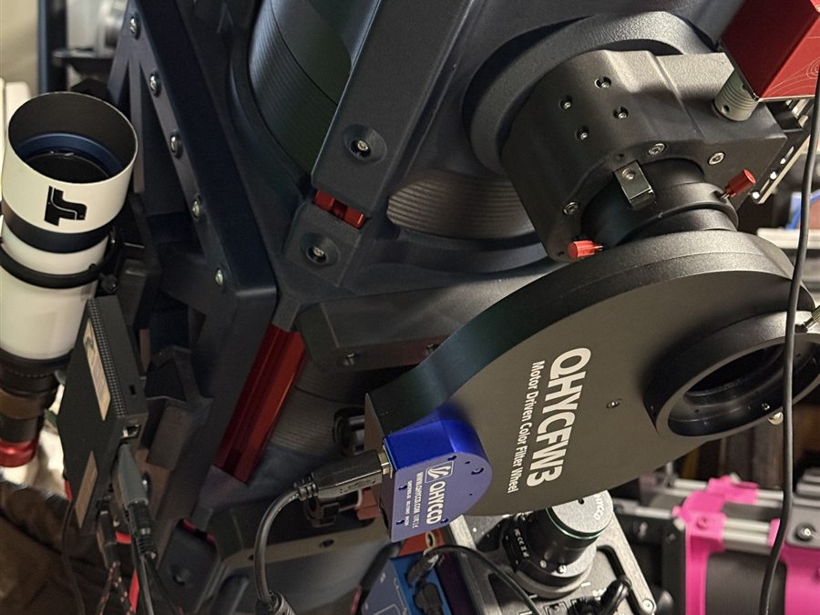
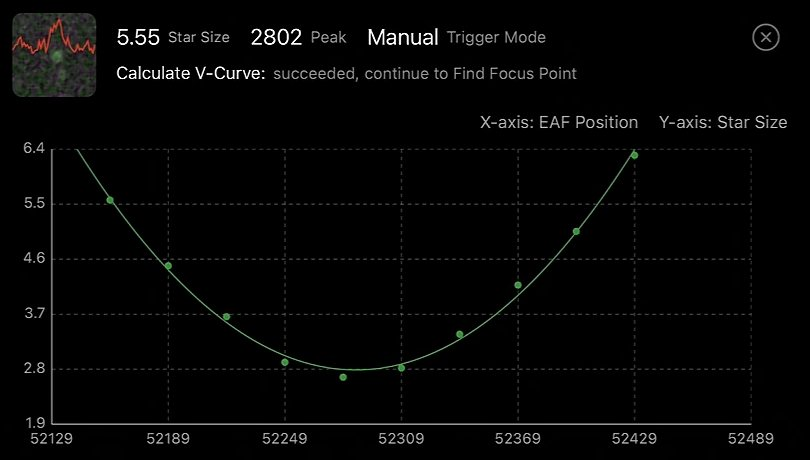
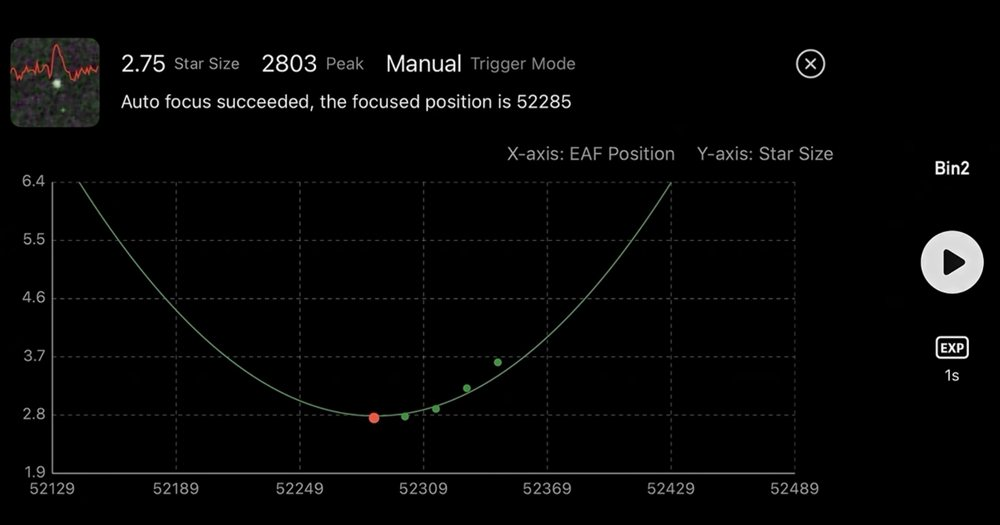
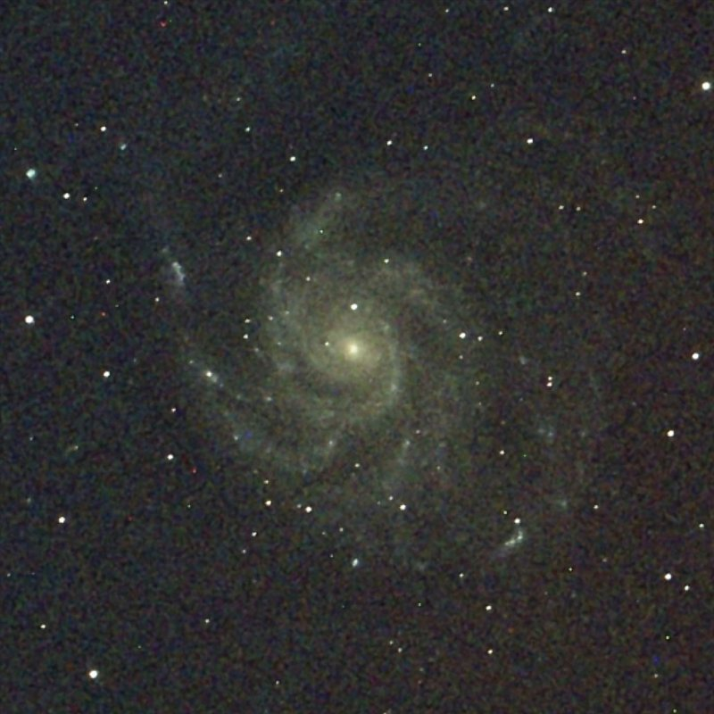
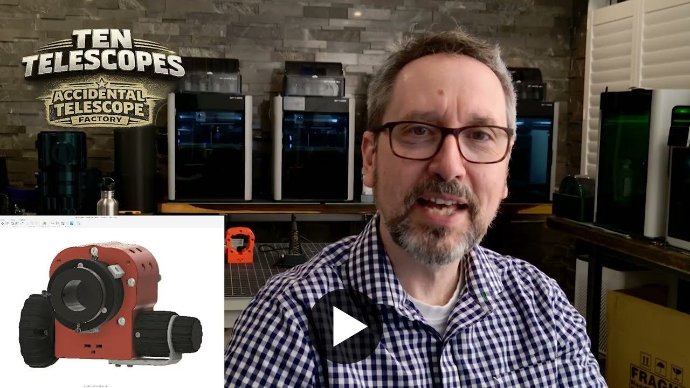

  

<h1 align="center">Ten Telescopes 2 Inch Focuser</h1>

  <strong>A heavy duty 2" Crayford focuser you can 3D print, with premium performance at a fraction of the cost.</strong> 
  Focus by hand with a 9:1 fine focus, or let an electronic auto focuser (EAF) do it. 
  Open source, from <a href="https://www.tentelescopes.com">Ten Telescopes</a> in Guelph, Ontario.

  <a href="https://youtu.be/elHSBOO0oG0">Build video</a> ·
  <a href="https://www.tentelescopes.com/post/repeatable-to-the-step-our-3d-printed-two-inch-focuser">How it works</a> ·
  <a href="https://discord.gg/kwv2z3wfGd">Discord</a>

---

This is the focuser on our [Skyward 200](https://github.com/TenTelescopes/Skyward200) and Skyward 150 Astrograph, and the 2" printed focuser option in our Skyward kits.

  

## How it works

- **Crayford style.** There's no rack and no gear teeth on the drawtube. A 4 mm stainless steel rod presses against the drawtube, and turning the rod moves the drawtube in or out by friction.
- **The plunger.** Under the rod, a half-round piece of PTFE tube is pushed up by two small screws. Those screws set how hard the rod presses on the drawtube, which is what lets the focuser carry a heavy camera without slipping. The final test: with the drawtube pointing straight up, it has to hold a 1 kg load without moving.
- **Three linear rails** keep the drawtube square, so it doesn't rock or sag, even with a camera, filter wheel and coma corrector on the end.
- **Coarse and fine focus.** A large knob for coarse focus, and a small knob that drives two planetary gear stages of 3:1 each, for 9:1 in total. The gears print in place, all in one piece.
- **EAF ready.** The [`EAF Adapters`](STL%20Files/EAF%20Adapters) folder has offset blocks for mounting an electronic auto focuser.

## On real telescopes

  
  
  

## Autofocus results

On June 22, 2026, on our Skyward 150 Astrograph "Indigo" with a ZWO EAF and a ZWO ASIAIR, the autofocus stepped across about 300 steps and every point sat close to a clean V-curve. It then came back to position 52285, right at the bottom of the curve. Indigo was using the budget 3D printed drawtube and a budget coma corrector.

  
  
  

The whole story is in [Repeatable to the Step: Our 3D Printed Two Inch Focuser](https://www.tentelescopes.com/post/repeatable-to-the-step-our-3d-printed-two-inch-focuser).

## Watch the build

  

Not sure which focuser to use? [Skyward Telescope Focuser Options](https://youtu.be/q8hDdoA1VfE) is a quick overview of the focusers you can buy or build for a Skyward.

## Start here

1. **Watch the [build video](https://youtu.be/elHSBOO0oG0).**
2. **Calibrate your printer for shrinkage first.** When it's right, a 2" accessory slides into the drawtube with no slop.
3. **Print the parts** from [`STL Files`](STL%20Files). Print the planetary gearsets with a 0.2 mm nozzle if you can. They come out much smoother.
4. **Pick a drawtube:**
   - The **3D printed drawtube**, the budget option. It's the one Indigo used for the results above.
   - A **DIY metal drawtube.** Print the drilling jig in [`Alternative Drawtube`](STL%20Files/Alternative%20Drawtube) and use it to drill and tap an aluminum tube.
5. **Ask questions** in [#skyward-build-questions on Discord](https://discord.gg/kwv2z3wfGd).

## What's in this repo

| File or folder | What's inside |
|---|---|
| [`STL Files`](STL%20Files) | Focuser body, drawtubes, coarse and fine focus parts, plunger, transfer plate, planetary gearsets (3MF) and a 2" to 1.25" adapter |
| [`STL Files/Alternative Drawtube`](STL%20Files/Alternative%20Drawtube) | Drilling jig and sleeve for an aluminum drawtube |
| [`STL Files/EAF Adapters`](STL%20Files/EAF%20Adapters) | Offset blocks for mounting an electronic auto focuser |
| [`2 Inch Collimation Tool.stl`](2%20Inch%20Collimation%20Tool.stl) | A 2" collimation tool |

## License

These designs are licensed under the [Creative Commons Attribution–NonCommercial 4.0 International License](https://creativecommons.org/licenses/by-nc/4.0/).

You are free to:

- Download, modify, and use for personal, non‑commercial purposes.
- Share adaptations with credit to **Ten Telescopes**.

You may **not**:

- Sell these designs.
- Sell physical products made from these designs without written permission.

For commercial inquiries: admin@tentelescopes.com
